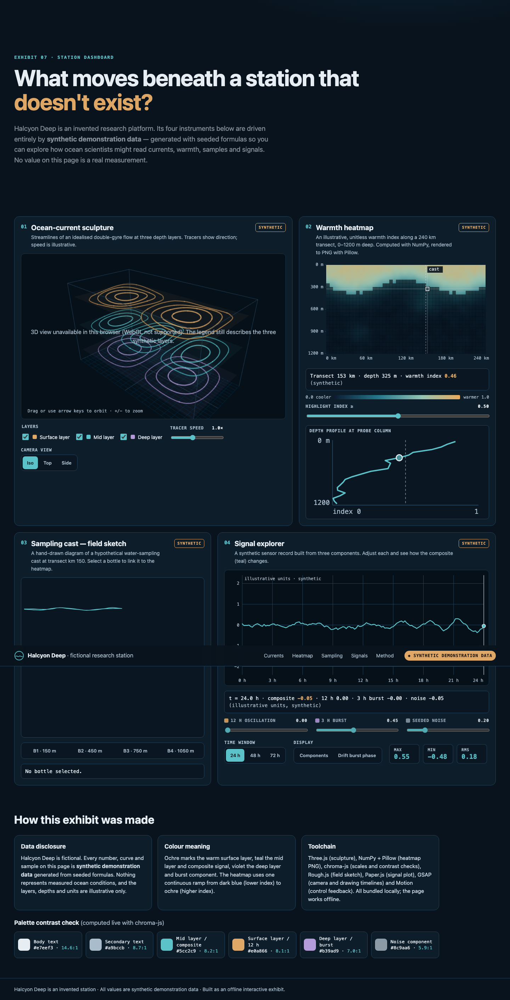
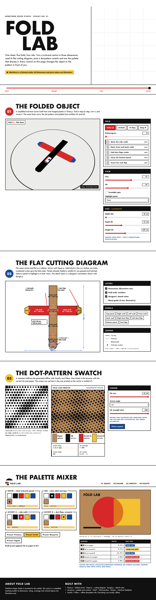

<p align="center">
  
</p>

<p align="center">
  <a href="https://releaseszn.com/p/kiteva"></a>
  <a href="https://github.com/delexw/motion-graphics-agent/releases/latest"></a>
  <a href="LICENSE"></a>
  <a href="https://github.com/delexw/motion-graphics-agent/actions/workflows/native-windows.yml"></a>
</p>

<h1 align="center">Kiteva — AI Motion Graphics Agent</h1>

Use Kiteva from external agents through its [MCP server](docs/agent-mcp.md): search ideas
and Motion Graphics, save an Assistant draft, and explicitly start a build.

<p align="center">
  <b>A personal creative room where an idea turns into a short motion-graphics film.</b><br>
  Create with <a href="https://platform.claude.com/docs/en/about-claude/models/overview">Claude Opus 5.5</a> or <a href="https://developers.openai.com/api/docs/models/gpt-6.1-sol">GPT-6.1 Sol</a>.
</p>

<p align="center">
  <b>English</b> · <a href="README.zh-CN.md">简体中文</a>
</p>

<p align="center">
  <a href="docs/assets/kiteva-intro.mp4">
    
  </a>
  <br>
  <sub>This film was made in Kiteva, from one real run: 28 seconds with local Kokoro narration and a music bed the film agent wrote in code. Above is a silent 14-second loop from the middle; click it for the full MP4 with sound. <a href="docs/intro-video.md">How it was made</a>.</sub>
</p>

Switch the interface instantly with **EN / 中文**; see [interface language](docs/ui-language.md). Video language remains a separate project setting.

## Demo showcase

Real Kiteva outputs: five MP4 films and two full-page HTML screenshots. The generated
HTML projects are not included. [Open the video gallery](docs/showcase.html) locally
for native players and full-length page captures.

<table>
  <tr>
    <th width="50%">Ocean research · video</th>
    <th width="50%">Stack / Turn / Pack · video</th>
  </tr>
  <tr>
    <td valign="top"><video controls playsinline preload="metadata" width="100%" src="docs/assets/showcase/ocean-research-film.mp4"></video><p><a href="docs/assets/showcase/ocean-research-film.mp4">Play MP4</a> · 10-second scientific/editorial film: currents, sampling and a synthetic heatmap.</p></td>
    <td valign="top"><video controls playsinline preload="metadata" width="100%" src="docs/assets/showcase/stack-turn-pack.mp4"></video><p><a href="docs/assets/showcase/stack-turn-pack.mp4">Play MP4</a> · 10-second Bauhaus/Swiss film: introduce three shapes, assemble them and pack the result.</p></td>
  </tr>
  <tr>
    <th>Character animation · Playful Cat</th>
    <th>Product demo · Stageshow + Swiss</th>
  </tr>
  <tr>
    <td valign="top"><video controls playsinline preload="metadata" width="100%" src="docs/assets/showcase/playful-cat.mp4"></video><p><a href="docs/assets/showcase/playful-cat.mp4">Play MP4</a> · A 50-second pixel-art cat story with Chinese narration and on-screen subtitles.</p></td>
    <td valign="top"><video controls playsinline preload="metadata" width="100%" src="docs/assets/showcase/stageshow-swiss-demo.mp4"></video><p><a href="docs/assets/showcase/stageshow-swiss-demo.mp4">Play MP4</a> · A 12-second simulated task-board walkthrough: open a task, assign a teammate and mark it ready. Stageshow-style light UI with Swiss framing and motion; silent.</p></td>
  </tr>
  <tr>
    <th>Ocean research · interactive HTML</th>
    <th>Fold Lab · interactive HTML</th>
  </tr>
  <tr>
    <td valign="top"><a href="docs/assets/showcase/ocean-research-full-page.png"></a><p>Full-page capture of the interactive research exhibit. All data is explicitly synthetic.</p></td>
    <td valign="top"><a href="docs/assets/showcase/fold-lab-full-page.png"></a><p>Full-page capture of the packaging exhibit: interactive folds, dimensions, a Python-generated dot pattern and a palette mixer.</p></td>
  </tr>
  <tr><th colspan="2">Fire truck · multilingual subtitles</th></tr>
  <tr><td colspan="2"><video controls playsinline preload="metadata" width="100%" src="docs/assets/showcase/fire-truck-multilingual.mp4"></video><p><a href="docs/assets/showcase/fire-truck-multilingual.mp4">Play MP4</a> · A user-created 90-second children's explainer with English narration and English/Chinese on-screen subtitles. This is a 720p showcase copy; the original remains unchanged.</p></td></tr>
</table>

GitHub's README renderer does not play repository-relative video embeds; the MP4
links remain available. The [local gallery](docs/showcase.html) uses real video
players, without replacing films with screenshots. Hosted inline GitHub playback
requires [uploaded video attachments](https://docs.github.com/en/get-started/writing-on-github/working-with-advanced-formatting/attaching-files).

## Recent updates

Only the latest three calendar days are listed here (New Zealand time). See the [changelog](CHANGELOG.md#daily-update-archive) for earlier daily updates and [release history](CHANGELOG.md).

<details>
<summary>2026-11-13</summary>

- **Governance and project technologies:** Server-side pagination, indexed project search and per-call costs make the reporting pages easier to inspect. Project filters retain the complete selector, and dependency readiness is separate from source and runtime usage evidence.
- **Project-owned dependencies:** Build manifests declare the selected tools and required runtime packages. Governance reports which technologies were selected, prepared and observed, including Python utilities.
- **Per-language media and refinements:** Narration and subtitles start disabled and are confirmed independently for each language. Version refinements can change supported voice providers and output settings without silently keeping an older profile.
- **Stageshow appearance boundaries:** User UI styling overrides Stageshow defaults; otherwise the demo retains its native appearance. Selected Motion Graphics contribute motion inside the demo. Planning, repair and result review use the same scene ownership rule.
- **Showcase and dependency maintenance:** The gallery includes the Playful Cat film and Swiss product demo as playable MP4s. Startup and installation share the dependency upgrade lifecycle, including Audio Studio; [agent guidance](AGENTS.md) documents module ownership, tool limits and mocked third-party tests.

</details>

<details>
<summary>2026-11-12</summary>

- **Stageshow product demos:** An optional startup-installed skill for authored UI walkthroughs with the selected MG contributing motion only. Upstream files stay Git-ignored; source contains only registration, adaptation guidance and tests. It preserves real-capture boundaries, renderer timing and third-party asset notices. See [integration and licensing](docs/stageshow.md).

- **Open motion discovery:** Direct builds and generated directions share a route table for reading selected Motion Graphics, resolving explicit `@` references and searching the full motion pool. Style candidates and motion `good_fit` lists are recommendations, not allowlists. The model preserves the selected visual identity, user requirements and scene scope; it need not inspect every motion or use one.

- **Five composable motion techniques:** Metaball Merge & Split (`motion-051`), Path Follow & Text on Path (`motion-052`), 3D Tile Flip (`motion-053`), Particle Glyph Assembly (`motion-054`) and Velocity Motion Blur (`motion-055`). Each has a seekable explorer preview, Chinese metadata and a frame-analysis record. A review of twelve common techniques found the other seven already covered. The catalog now has 55 motions.

</details>

## Editable project downloads

Full versions offer **Download editable project** whenever source or media files exist, including failed, cancelled and incomplete builds. The streamed ZIP contains renderer sources and assets, dependency manifests, an OpenTimelineIO timeline, SRT subtitles from the storyboard, and usable rendered media. Rendered scenes remain clips, with available music/narration tracks; the rendered audio mix is preserved as a reference or fallback. Burned-in graphics/captions stay flattened in clips; edit the included native renderer sources to change them. Editor import support varies. Missing renders are reported in `export.json`; a source-only export does not imply a successful build. See [editable project exports](docs/editable-projects.md) for the ZIP layout, timeline construction and editing limitations.

## Why this exists

I'm not a professional designer. I'm a full-stack engineer working on content and creative tools,
and along the way I picked up a few creative ideas. Then I noticed [Opus 5.5](https://platform.claude.com/docs/en/about-claude/models/overview) has a real feel for this
kind of work. There's an internal hackathon coming up at my company, and I just find these motion
effects fun, so I started collecting motion pieces that had that certain something, along with notes
on what technology could make each one. The pile got big. So I built an agent to put that collection
and Opus 5.5 to work, to see how far it could go. The results surprised me, so I'm sharing the agent's
source here, under the MIT license.

I collected a lot. Some of it is dazzling, and some of it is probably wrong. I kept it all anyway 😄

Opus 5.5 is my favourite for the creative part. The [Codex](https://developers.openai.com/codex) provider with [GPT-6.1 Sol](https://developers.openai.com/api/docs/models/gpt-6.1-sol) is wired up too,
and I'm trying it out for fun. You choose the provider per project.

## What it does

**Idea → brief → Motion Graphic combinations → previews → full film → review and delivery**

<p align="center">
  
  <br><sub>The room right after the intro film finished. The Assistant starts a new idea; each project lives in its own widget.</sub>
</p>

- **A desktop-style room.** Everything happens in windows on a personal desktop: an assistant that
  walks you through the idea, documents, images, websites, music and subtitles, and settings, plus a material
  shelf and one widget per project. Nothing calls a model until you press **Create**.
- **A brief from your references.** A small model reads your files and, if you add websites, opens
  them in a fresh headless [Chromium](https://www.chromium.org) browser to take screenshots. It writes a structured brief and then checks it.
- **Motion Graphic combinations.** The main model reads summaries of all 140 Motion Graphics and
  proposes a dozen or more directions. Each pairs one primary Motion Graphic with supporting ones. A
  separate evaluator, [Typesafe](https://docs.typesafe.ai)'s [JEV](https://docs.typesafe.ai/models), scores them and keeps the number of directions you asked for (1–5).
- **Silent 3-second previews** of the same story beat, one per direction, so you can compare.
- **The full film** continues the preview session you picked, at 1080p or 1440p, 30 or 60 fps, up to
  5 minutes, with optional on-screen subtitles and local narration ([Kokoro](https://huggingface.co/hexgrad/Kokoro-82M) or
  [Pocket TTS](https://pypi.org/project/pocket-tts/)).
- **Review and delivery.** Every render is probed with `ffprobe` and fully decoded. With
  [HyperFrames](https://github.com/heygen-com/hyperframes), the default renderer, layout and contrast checks run
  too, and findings are repaired in focused rounds. The [Multiplane](https://github.com/LBEILC/Multiplane) trial
  skips those two checks and verifies frame consistency instead. A small model then reviews the result. You get
  an MP4, a poster, a project ZIP, a playback copy and a Storyboard.

<table>
  <tr>
    <td width="50%"></td>
    <td width="50%"></td>
  </tr>
  <tr>
    <td><sub>Explore all 136 Motion Graphics. Each card plays a reviewed 3-second demo.</sub></td>
    <td><sub>The two directions Kiteva previewed for the film above. I picked Paper Room.</sub></td>
  </tr>
</table>

### The Storyboard

<p align="center">
  
  <br><sub>The intro film's own Storyboard, caught during scene 2 of 9.</sub>
</p>

Every preview and film saves a `STORYBOARD.json` with timed scenes, beats, captions and audio notes
that match the actual composition. The Storyboard page plays it back as a little behind-the-scenes
rehearsal. A stick-figure director and crew (stagehand, lighting, lettering, sound, camera) walk to their
marks when a beat calls for their job, and you can play, replay or scrub through the film's timeline.

To be honest about what it is: the crew is a playful reading of the recorded cues, not real production
staff and not a live render monitor. Live progress is in each project's activity lines in the room.
And it has nothing to do with the UI-component tool called [Storybook](https://storybook.js.org).

## Numbers, counted from the source

|                                   |                                                                                                                                                                                      |
| --------------------------------- | ------------------------------------------------------------------------------------------------------------------------------------------------------------------------------------ |
| Motion Graphics                   | **140** (`assets/catalog/video-style-catalog.json`)                                                                                                                                  |
| Motions                           | **46** (`assets/catalog/motion-pattern-catalog.json`)                                                                                                                                |
| Technology pool entries           | **92** recommendations across visual construction, motion, rendering and supporting tools                                                                                            |
| Startup-installed authoring skill | **3** ([Anatomy](https://github.com/wheresryan22/anatomy), [img2threejs](https://github.com/img2threejs/img2threejs), [Stageshow](docs/stageshow.md))                                |
| Renderers                         | [HyperFrames](https://github.com/heygen-com/hyperframes) (default), [Multiplane](https://github.com/LBEILC/Multiplane) (trial), [Remotion](https://www.remotion.dev) (fallback only) |

Combinations are where it gets interesting. A direction can mix one primary Motion Graphic with
supporting ones (at least 2 in generated combinations: 2–3 under 30 seconds, 2–4 at 30–59 seconds, 2–5 at 60–179 seconds and 2–6 at 180–300 seconds), and the
model picks motions and technologies to suit. That gives far more starting points than any single
style. It doesn't promise that every combination works. Some won't, which is why there are previews,
an evaluator and repairs.

## Who does what

| Job                                                                          | Claude projects                                                                         | Codex projects                                                           |
| ---------------------------------------------------------------------------- | --------------------------------------------------------------------------------------- | ------------------------------------------------------------------------ |
| Brief, reference checks, Motion Graphic summaries, subtitles, simple repairs | [Claude Haiku 5.5](https://platform.claude.com/docs/en/about-claude/models/overview)    | [GPT-6 Luna](https://developers.openai.com/api/docs/models/gpt-6-luna)   |
| Combination proposals, previews, the full film, pacing/style repairs         | **[Claude Opus 5.5](https://platform.claude.com/docs/en/about-claude/models/overview)** | [GPT-6.1 Sol](https://developers.openai.com/api/docs/models/gpt-6.1-sol) |
| Finished-result review                                                       | Same model that built the result                                                        | Same model that built the result                                         |
| Scoring and choosing directions                                              | [JEV](https://docs.typesafe.ai/models) via [Typesafe](https://docs.typesafe.ai)         | [JEV](https://docs.typesafe.ai/models)                                   |
| Recording every call, token count and cost estimate                          | Governance report                                                                       | Governance report                                                        |

More detail, including the workflow diagrams, is in [docs/architecture.md](docs/architecture.md).

## Quick start

Native Windows 10/11 setup is experimental and has its own [installation and verification guide](docs/windows.md); WSL is not required.

On macOS, [install.sh](install.sh) installs missing system prerequisites, locked npm dependencies (with Claude and Codex SDKs refreshed to `latest`), isolated Chrome for Testing, OpenScreen, Caveman, local speech providers and Audio Studio MCP with model weights, then builds the app. It uses Homebrew when system tools are missing and managed Python 3.11 for speech. Existing configuration and installed apps are preserved. The default setup includes large model downloads; see `./install.sh --help` for options. Setup and backend launches share the [managed dependency update lifecycle](docs/dependency-upgrades.md). You still need two kinds of access:

- **A model provider, by API key or by an existing signed-in subscription.** For Claude, set
  `ANTHROPIC_API_KEY` or `CLAUDE_CODE_OAUTH_TOKEN`, or just be signed in to
  [Claude Code](https://code.claude.com/docs/en/overview) on this Mac. For Codex, set `CODEX_API_KEY` or
  `OPENAI_API_KEY`, or be signed in to the [Codex CLI](https://developers.openai.com/codex) (`~/.codex/auth.json`).
  Subscriptions work, but I haven't tested how subscription usage or remaining percentage is reported.
- **[JEV](https://docs.typesafe.ai/models), configured separately.** Put `TYPESAFE_API_KEY` in `.env.local`.
  It is used for generated style directions and visual/audio capability selection. Manually selecting Motion Graphics skips style ranking, while capability decisions remain separate.

```sh
git clone https://github.com/delexw/motion-graphics-agent.git
cd motion-graphics-agent
./install.sh
# Edit the created .env.local: add TYPESAFE_API_KEY and provider keys if needed.
npm start                       # open http://127.0.0.1:18417
```

For a smaller installation, use `./install.sh --minimal` to skip speech and Audio Studio, or
`./install.sh --speech pocket` to install only Pocket TTS narration. `--audio-no-weights` defers Audio
Studio model downloads until first generation. The default installs Kokoro, Pocket TTS, Mandarin
Pocket TTS and, on Apple Silicon, Ming TTS using the existing `speech:setup*` scripts. See [speech setup](docs/speech.md) and
[language controls](docs/video-languages.md). Provider sign-in/API keys and macOS Screen Recording
and Accessibility permissions require your action; the installer does not start the app or operate
your browser. OpenScreen downloads come from its official GitHub releases and are SHA-256 checked;
if `/Applications` is not writable, its user Applications path is added to `.env.local`.
For UI development, keep the backend running and use `npx vite` ([Vite](https://vite.dev),
`http://127.0.0.1:18419`).

Anatomy installs or updates automatically on server launch. Connect to the internet for the first launch; skill installation uses direct HTTPS ZIP downloads and needs no Git or extra CLI; later launches can use the last verified installation offline. Upstream files stay in Git-ignored `skills/anatomy/`, while provider registration and Kiteva guidance remain in source.

[img2threejs](https://github.com/img2threejs/img2threejs) downloads the latest default-branch commit at every backend startup through the same loader, matching Anatomy. JEV compares it with Anatomy and the other authoring resources: reference-driven procedural 3D reconstruction versus explanatory technical illustrations. Both providers receive the skill and a local timeline/camera helper. Python 3.10+ is needed when using its forge scripts; no hosted reconstruction service or optional character plugin is installed. See [workflow, video adaptation and limitations](docs/img2threejs.md).

[React Bits](https://github.com/DavidHDev/react-bits) and [Animate UI](https://github.com/imskyleen/animate-ui) provide component discovery during planning and source installation during building. JEV selects suitable capabilities, bundled skills or local code for each job. See [integration and licensing](src/server/agents/capabilities/README.md).

[Audio Studio MCP](https://github.com/kanaworksai-hue/audio-studio-mcp) adds local music and sound-effect generation for both providers. A separate JEV Choice strategy selects Audio Studio or local code-based audio authoring when a full video has a Music prompt and no uploaded music. Uploaded audio retains its existing guidance; previews remain silent. For Multiplane, the agent is instructed to generate and verify a WAV first, then supply its path through `production.audioFile` for `--audio`. See [Audio Studio setup and integration](src/server/agents/capabilities/README.md#audio-studio-mcp) and the [JEV strategies](src/server/jev/README.md).

The catalogs, reviewed artwork and 140 preview clips ship with the repo, so browsing costs nothing.
Your projects, uploads, room layout, databases and credentials stay in Git-ignored folders on your machine.

## What ships, and what you install

| Part                                                                                                                                                                                                                                                                          | What it is                                                                                                                                           | Status                                                                                                                                     |
| ----------------------------------------------------------------------------------------------------------------------------------------------------------------------------------------------------------------------------------------------------------------------------- | ---------------------------------------------------------------------------------------------------------------------------------------------------- | ------------------------------------------------------------------------------------------------------------------------------------------ |
| [Anatomy](https://github.com/wheresryan22/anatomy)                                                                                                                                                                                                                            | Isometric technical-illustration skill and drawing kit (3D mode is beta)                                                                             | Installed/updated from upstream at launch into Git-ignored `skills/anatomy/`; verified local fallback when offline; MIT                    |
| [img2threejs](https://github.com/img2threejs/img2threejs)                                                                                                                                                                                                                     | Reference-image procedural Three.js reconstruction skill                                                                                             | Latest default-branch commit installed at every backend startup into Git-ignored `skills/img2threejs/`; verified offline reuse; Apache-2.0 |
| [Stageshow](docs/stageshow.md)                                                                                                                                                                                                                                                | Authored product-UI illustrations, cursor interactions and walkthroughs                                                                              | Startup download into Git-ignored runtime storage; MIT source with separate asset notices; does not replace real application recording     |
| [HyperFrames](https://github.com/heygen-com/hyperframes)                                                                                                                                                                                                                      | HTML video composition and export                                                                                                                    | npm dependency; compatible range and committed lockfile; default renderer                                                                  |
| [Multiplane](https://github.com/LBEILC/Multiplane)                                                                                                                                                                                                                            | `render(t)` shot renderer with motion blur                                                                                                           | npm dependency; compatible range and committed lockfile; trial setting                                                                     |
| [Remotion](https://www.remotion.dev) 4.x                                                                                                                                                                                                                                      | React video renderer                                                                                                                                 | npm dependency, fallback only (has its own license terms)                                                                                  |
| `reference_browser` / `capture_video`                                                                                                                                                                                                                                         | Website inspection via [Puppeteer](https://pptr.dev); recording via local or worker [OpenScreen](https://github.com/getopenscreen/openscreen) worker | Built into Kiteva, for both providers                                                                                                      |
| [Kokoro](https://github.com/thewh1teagle/kokoro-onnx), [Pocket TTS](https://pypi.org/project/pocket-tts/)                                                                                                                                                                     | Local narration                                                                                                                                      | Python set up by `npm run speech:setup*`. Weights downloaded to Git-ignored `models/`                                                      |
| [Claude Agent SDK](https://github.com/anthropics/claude-agent-sdk-typescript), [Codex SDK](https://github.com/openai/codex/tree/main/sdk/typescript), [`@typesafe-ai/sdk`](https://docs.typesafe.ai/sdk/javascript)                                                           | Model providers and JEV                                                                                                                              | npm dependencies                                                                                                                           |
| [Caveman](https://github.com/JuliusBrussee/caveman)                                                                                                                                                                                                                           | Local token-compression proxy for SDK calls                                                                                                          | npm dependency, on by default                                                                                                              |
| [GSAP](https://gsap.com), [Three.js](https://threejs.org), [PixiJS](https://pixijs.com), [Paper.js](http://paperjs.org), [Rough.js](https://roughjs.com), [Motion](https://motion.dev), [chroma.js](https://gka.github.io/chroma.js/), [Pica](https://github.com/nodeca/pica) | Drawing and motion libraries offered to generated films                                                                                              | npm dependencies                                                                                                                           |
| [React](https://react.dev), [Ant Design](https://ant.design) + [Ant Design X](https://x.ant.design), [Radix](https://radix-ui.com), [Tailwind CSS](https://tailwindcss.com), [Vite](https://vite.dev), [Fastify](https://fastify.dev), [Zod](https://zod.dev)                 | App UI, server and shared contracts                                                                                                                  | npm dependencies                                                                                                                           |
| [FFmpeg](https://ffmpeg.org), [Chrome](https://www.google.com/chrome/)/[Chromium](https://www.chromium.org), [Python](https://www.python.org), [Blender](https://www.blender.org) (optional)                                                                                  | External tools                                                                                                                                       | Not bundled. `install.sh` sets up the supported macOS tools; Blender remains optional and separate                                         |

Being in the 92-entry technology pool doesn't mean a library is installed. Twelve pool entries are
recommendations only, and generation can't install packages or use the network. The full list with a
status for every entry, plus all 77 direct npm dependencies, is in [docs/technology-pool.md](docs/technology-pool.md).

## What it costs

From Kiteva's own governance report (snapshot 2026-10-17, app pricing date 2026-10-13), my three
earlier development projects (all Claude, 90–120 s films, five preview directions each) came to
**$16.46, $18.73 and $37.42** in SDK-estimated, API-equivalent model usage. More than 90 % of input
tokens were cache reads. Nearly all of the cost is Opus writing previews and the film. Haiku's
preparation and review work cost cents, and JEV ranking under a cent. The expensive one regenerated
its directions and needed nine repair calls.

That's three projects, not a benchmark or a per-minute price. Local compute (render time, electricity)
isn't priced, and there's no GPT-6.1 Sol example yet. These are token counts priced at API rates. If
you're signed in with a subscription instead of an API key, they are **not** your bill and not a meter of
your plan's allowance. I haven't tested subscription usage or remaining-percentage reporting. Method and caveats:
[docs/costs.md](docs/costs.md).

## Known limits

- macOS is the tested platform. Native Windows 10/11 support is experimental; see [Windows setup and required checks](docs/windows.md). Single user, local only.
- [Multiplane](https://github.com/LBEILC/Multiplane) is a trial: one sound file, recorded clips require prepared frames, and there are no automatic layout or contrast checks (frame consistency is still verified).
- [Remotion](https://www.remotion.dev) is a fallback, not a setting, and its renders skip the HyperFrames layout/contrast checks too.
- No generated singing, image generation or stock footage. Visuals are drawn in code, or come from your uploads and website captures.
- The catalog is my personal collection. Some descriptions or technology suggestions may be off. Issues are welcome.
- Generation takes a while, often many minutes per preview, and uses real API credit or subscription usage.

## Docs

- [Editable project exports](docs/editable-projects.md): OTIO, captions, audio tracks, source bundles and failed builds
- [Architecture](docs/architecture.md): components, [three video generation routes](docs/architecture.md#video-generation-routes), renderers, capture, skills, storage (Mermaid diagrams)
- [Prompt routes A–D](docs/architecture.md#prompt-routes) · [Subworkflow diagrams](src/server/jobs/subworkflows/README.md#subworkflow-diagrams)
- [Technology inventory](docs/technology-pool.md): all 92 pool entries, the startup-installed skill, renderers, TTS and every dependency
- [Costs](docs/costs.md): how the governance numbers are computed
- [Intro film provenance](docs/intro-video.md): how the film above was made in Kiteva
- [README references](docs/readme-references.md): open projects whose READMEs I learned from
- [Application guide](docs/application-guide.md) · [Speech setup](docs/speech.md) · [Multiplane trial](docs/multiplane-trial.md)

## Contributing

Bug reports, catalog corrections and focused PRs are welcome. See [CONTRIBUTING.md](CONTRIBUTING.md)
for setup, the checks to run (`npm run lint`, `npm test`, `npm run build`), the creative quality bar
(seekable compositions, real rendered frames) and third-party rules.

## License

[MIT](LICENSE) © 2026 Yang Liu. Third-party components retain their own licenses; see [dependency licenses](docs/technology-pool.md#licenses).

Website video recording uses [OpenScreen](docs/openscreen-worker.md) locally by default, in a dedicated visible browser window. An isolated desktop worker is optional.
