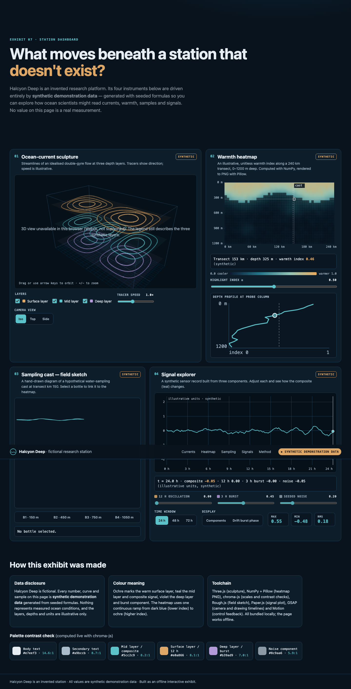
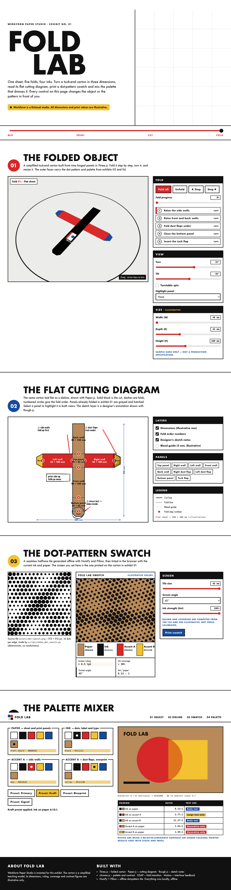

<p align="center">
  
</p>

<p align="center">
  <a href="https://releaseszn.com/p/kiteva"></a>
  <a href="https://github.com/delexw/motion-graphics-agent/releases/latest"></a>
  <a href="LICENSE"></a>
  <a href="https://github.com/delexw/motion-graphics-agent/actions/workflows/native-windows.yml"></a>
</p>

<h1 align="center">Kiteva — AI 动态图形智能体</h1>

通过 [MCP 服务](docs/agent-mcp.md)在外部智能体中使用 Kiteva：搜索想法和 Motion Graphic、
保存 Assistant 草稿，并在明确请求后启动构建。

<p align="center">
  <b>一个私人的创作小房间，把一个想法变成一段动态图形短片。</b><br>
  使用 <a href="https://platform.claude.com/docs/en/about-claude/models/overview">Claude Opus 5.5</a> 或 <a href="https://developers.openai.com/api/docs/models/gpt-6.1-sol">GPT-6.1 Sol</a>。
</p>

<p align="center">
  <a href="README.md">English</a> · <b>简体中文</b>
</p>

<p align="center">
  <a href="docs/assets/kiteva-intro.mp4">
    
  </a>
  <br>
  <sub>这部短片由 Kiteva 真实运行一次做出：28 秒，带本地 Kokoro 旁白，背景音乐是成片 agent 用代码写出来的。上面是从中段截取的 14 秒无声循环，点击可打开带声音的完整 MP4。<a href="docs/intro-video.md">制作过程</a>。</sub>
</p>

通过 **EN / 中文** 即时切换界面，详见[界面语言](docs/ui-language.md)。视频语言仍是独立的项目设置。

## 成品展示

以下是 Kiteva 的真实成品：五段 MP4 视频和两个 HTML 网页的完整长截图，
不包含生成的 HTML 项目源码。[本地打开视频展示页](docs/showcase.html)，可使用原生播放器观看视频和查看完整页面。

<table>
  <tr><th width="50%">海洋研究 · 视频</th><th width="50%">Stack / Turn / Pack · 视频</th></tr>
  <tr>
    <td valign="top"><p><a href="https://github.com/user-attachments/assets/538e1aaf-ef40-47fa-8548-4a91e1359a9c">https://github.com/user-attachments/assets/538e1aaf-ef40-47fa-8548-4a91e1359a9c</a></p><p><a href="docs/assets/showcase/ocean-research-film.mp4">播放 MP4</a> · 10 秒科学编辑风格短片，展示洋流、采样过程和合成热力图。</p></td>
    <td valign="top"><p><a href="https://github.com/user-attachments/assets/ddfb819c-b188-428d-b4a6-2ea1fba136ed">https://github.com/user-attachments/assets/ddfb819c-b188-428d-b4a6-2ea1fba136ed</a></p><p><a href="docs/assets/showcase/stack-turn-pack.mp4">播放 MP4</a> · 10 秒包豪斯／瑞士平面风格短片：介绍三个形状、组装、装箱。</p></td>
  </tr>
  <tr><th>角色动画 · Playful Cat</th><th>产品演示 · Stageshow + Swiss</th></tr>
  <tr>
    <td valign="top"><p><a href="https://github.com/user-attachments/assets/028abfcb-4171-4ed9-842a-fa7aafb66346">https://github.com/user-attachments/assets/028abfcb-4171-4ed9-842a-fa7aafb66346</a></p><p><a href="docs/assets/showcase/playful-cat.mp4">播放 MP4</a> · 50 秒像素风猫咪日常，包含中文旁白和画面字幕。</p></td>
    <td valign="top"><p><a href="https://github.com/user-attachments/assets/4c2b98ac-3dc9-4b94-afb3-3d659686729b">https://github.com/user-attachments/assets/4c2b98ac-3dc9-4b94-afb3-3d659686729b</a></p><p><a href="docs/assets/showcase/stageshow-swiss-demo.mp4">播放 MP4</a> · 12 秒模拟任务看板演示：打开任务、分配同伴、标为就绪。保留 Stageshow 风格的浅色界面，配合瑞士风格外围排版和动效，无声。</p></td>
  </tr>
  <tr><th>海洋研究 · 交互网页</th><th>Fold Lab · 交互网页</th></tr>
  <tr>
    <td valign="top"><a href="docs/assets/showcase/ocean-research-full-page.png"></a><p>交互研究展台的整页截图，数据明确标为合成演示数据。</p></td>
    <td valign="top"><a href="docs/assets/showcase/fold-lab-full-page.png"></a><p>包装设计展台的整页截图，包含折叠与尺寸控制、Python 生成的点阵图案和调色器。</p></td>
  </tr>
  <tr><th colspan="2">消防车 · 多语言字幕</th></tr>
  <tr><td colspan="2"><p><a href="https://github.com/user-attachments/assets/7950ecda-2593-4e5c-ba7f-15a0e0addcca">https://github.com/user-attachments/assets/7950ecda-2593-4e5c-ba7f-15a0e0addcca</a></p><p><a href="docs/assets/showcase/fire-truck-multilingual.mp4">播放 MP4</a> · 用户创建的 90 秒儿童讲解视频，包含英文旁白及英／中双语画面字幕。展示副本为 720p，原始成品保持不变。</p></td></tr>
</table>

视频使用 GitHub 托管的附件，可直接在 README 中播放。仓库内的 MP4 链接和
[本地展示页](docs/showcase.html)仍可用于本地观看。

## 最近更新

这里只保留最近三个自然日的更新（新西兰时间）。更早的每日记录见[变更日志](CHANGELOG.md#daily-update-archive)，版本发布记录见[完整 changelog](CHANGELOG.md)。

<details>
<summary>2026-11-13</summary>

- **Governance 与项目技术：**使用服务端分页、索引项目搜索和逐次模型调用费用；筛选项目后仍保留完整选择列表，区分依赖就绪、源码使用和运行时使用证据。
- **项目独立依赖：**构建清单记录模型选择的工具及必需运行库。Governance 分别报告技术是否选中、准备完成和实际观察到使用，包括 Python 工具。
- **逐语言媒体与版本修改：**旁白和字幕默认关闭，按语言分别确认。修改版本可切换受支持的语音提供方及输出设置，不再静默沿用旧版本配置。
- **Stageshow 样式边界：**用户的界面样式要求优先；未指定时保留 Stageshow 默认外观，所选 MG 只负责 demo 内动效。规划、修复和结果审阅共用同一职责规则。
- **成品展示与依赖维护：**展示页加入 Playful Cat 和 Swiss 产品演示的实际 MP4。启动与安装共用依赖升级流程，包含 Audio Studio；[开发指导](AGENTS.md)记录模块归属、工具边界及第三方调用的 mock 测试要求。

</details>

<details>
<summary>2026-11-12</summary>

- **Stageshow 产品 demo：**通过现有安装器下载到 Git 忽略的运行目录，源码只保留注册、适配指导和测试。JEV 可选择它创作模拟 UI；用户要求可覆盖默认界面样式，所选 MG 只负责 demo 内的动效、节奏和转场；不替代真实录制或渲染器。保留 MIT 与第三方素材 notices，视频采用绝对时间状态。[接入说明](docs/stageshow.md)。

- **开放的动作检索：**直接制作和生成方向共用路由表，指导模型读取所选 Motion Graphic、解析明确的 `@` 引用，并按场景需要搜索完整动作库。风格的候选动作和动作的 `good_fit` 列表只是建议，不是白名单；保留所选视觉风格、用户要求及场景范围，无须遍历或强制使用动作。

- **五种可组合的动效技法：**液态融合与分裂（`motion-051`）、路径跟随与路径文字（`motion-052`）、三维瓷砖翻转（`motion-053`）、粒子聚合成字（`motion-054`）和速度动态模糊（`motion-055`）。每种都有可跳转的浏览器预览、中文元数据和逐帧分析记录。对十二种常见技法的审阅发现，其余七种已有覆盖。目录现有 55 个动作。

</details>

## 下载可编辑项目

只要完整版本已产生源文件或媒体文件，即可下载可编辑项目，包括失败、取消及未完成的构建。流式 ZIP 包包含渲染器源文件、素材、依赖清单、OpenTimelineIO 时间线、从分镜提取的 SRT 歌词及可用的渲染媒体。渲染场景保留为视频片段，并提供可用的音乐和旁白轨道；最终混音作为参考或后备音轨。已烧录的图形和字幕不会自动变成独立图层，需要修改随包提供的原生渲染源文件。不同编辑器的导入支持可能不同。缺失输出记录在 `export.json` 中；仅有源文件的导出不代表构建成功。 ZIP 目录结构、时间线构建方式和编辑限制见[可编辑项目导出指南](docs/editable-projects.md)（英文）。

## 为什么会有它

本人并不是专业设计师，在内容和创作领域做全栈工程师，接触了一些些 creative 的 idea。正好发现
[Opus 5.5](https://platform.claude.com/docs/en/about-claude/models/overview) 很有灵性，最近公司内部又在准备 Hackathon，自己也觉得这些动效很有意思，于是开始搜集一些很有感觉的动效，
以及它们可以用什么技术实现。搜集得越来越多，就写了一个 agent 去利用这些内容和 Opus 5.5 的能力，想看看到底能做成什么样。
结果效果挺出人意料的，于是把这个 agent 的源码分享出来，采用 MIT 许可。

搜集了这么多，有非常炫的材料，也有可能有不对的，反正先都收集了 😄

创意部分我最喜欢用 Opus 5.5。[Codex](https://developers.openai.com/codex) 那边的 [GPT-6.1 Sol](https://developers.openai.com/api/docs/models/gpt-6.1-sol) 也接好了，我在玩着试试。每个项目可以单独选择用哪一家。

## 它能做什么

**想法 → 简报 → Motion Graphic 组合 → 预览 → 完整成片 → 审阅与交付**

<p align="center">
  
  <br><sub>介绍短片刚做完时的房间。助手用来开始新想法，每个项目都有自己的小组件。</sub>
</p>

- **桌面式的房间。** 一切都在个人桌面上的窗口里进行。助手一步步带你填写想法、文档、图片、网站、
  音乐与歌词、设置，旁边还有素材架和每个项目的小组件。按下 **Create** 之前不会调用任何模型。
- **从参考资料生成简报。** 小模型读取你的文件。如果你提供了网站，它会在全新的无头 [Chromium](https://www.chromium.org) 浏览器里打开并截图，
  然后写出结构化简报，再自查一遍。
- **Motion Graphic 组合。** 主模型阅读全部 140 种 Motion Graphic 的摘要，提出十几个甚至更多方向，
  每个方向由一个主 Motion Graphic 搭配若干辅助 Motion Graphic 组成。随后由独立的评估器（[Typesafe](https://docs.typesafe.ai) 的 [JEV](https://docs.typesafe.ai/models)）
  打分，保留你要求的方向数（1–5 个）。
- **3 秒无声预览。** 每个方向都演绎同一个故事节拍，方便对比。
- **完整成片。** 在你选中的预览会话基础上继续制作，支持 1080p 或 1440p、30 或 60 fps，最长 5 分钟，
  可加屏幕歌词和本地旁白（[Kokoro](https://huggingface.co/hexgrad/Kokoro-82M) 或 [Pocket TTS](https://pypi.org/project/pocket-tts/)）。
- **审阅与交付。** 每次渲染都会用 `ffprobe` 探测并完整解码。使用默认渲染器
  [HyperFrames](https://github.com/heygen-com/hyperframes) 时，还会做布局和对比度检查，发现的问题分轮做有针对性的修复；
  [Multiplane](https://github.com/LBEILC/Multiplane) 试用版不做这两项检查，改为校验帧的一致性。之后再由小模型审阅结果。
  最后交付 MP4、封面图、项目 ZIP、播放副本和 Storyboard。

<table>
  <tr>
    <td width="50%"></td>
    <td width="50%"></td>
  </tr>
  <tr>
    <td><sub>浏览全部 136 种 Motion Graphic，每张卡片播放一段审阅过的 3 秒演示。</sub></td>
    <td><sub>Kiteva 为上面这部短片预览的两个方向，我选了 Paper Room。</sub></td>
  </tr>
</table>

### Storyboard（分镜）

<p align="center">
  
  <br><sub>介绍短片自己的 Storyboard，截图时正播到 9 个场景中的第 2 场。</sub>
</p>

每个预览和成片都会保存一份 `STORYBOARD.json`，里面是与实际合成一致的带时间的场景、节拍、字幕和音频说明。
Storyboard 页面把它回放成一段小小的“幕后排练”：一位火柴人导演和剧组（场务、灯光、字效、音效、摄影），
在节拍需要自己的工种时走到位置上干活。你可以播放、重播，或拖动时间轴查看。

老实说明一下：这些剧组角色只是对已记录节拍的一种趣味演绎，不是真实的制作人员，也不是实时的渲染监控。
实时进度在房间里每个项目的活动记录中。另外，它和那个叫 [Storybook](https://storybook.js.org) 的 UI 组件工具毫无关系。

## 数字（从源码统计）

|                      |                                                                                                                                                                                |
| -------------------- | ------------------------------------------------------------------------------------------------------------------------------------------------------------------------------ |
| Motion Graphic       | **140** 种（`assets/catalog/video-style-catalog.json`）                                                                                                                        |
| 动作（motions）      | **46** 种（`assets/catalog/motion-pattern-catalog.json`）                                                                                                                      |
| 技术池条目           | **92** 条推荐，涵盖视觉构建、运动、渲染和辅助工具                                                                                                                              |
| 启动时安装的创作技能 | **3** 个（[Anatomy](https://github.com/wheresryan22/anatomy)、[img2threejs](https://github.com/img2threejs/img2threejs)、[Stageshow](docs/stageshow.md)）                      |
| 渲染器               | [HyperFrames](https://github.com/heygen-com/hyperframes)（默认）、[Multiplane](https://github.com/LBEILC/Multiplane)（试用）、[Remotion](https://www.remotion.dev)（仅作后备） |

有意思的是组合。一个方向可以把一个主 Motion Graphic 和若干辅助 Motion Graphic 混在一起（自动生成的组合至少包含 2 种；不足 30 秒为 2–3 种，30–59 秒为 2–4 种，
60–179 秒为 2–5 种，180–300 秒为 2–6 种），再由模型挑选合适的动作和技术。这样能得到的起点远比单一风格多。但这不保证每种组合都好用，
有些就是不行，所以才需要预览、评估器和修复。

## 分工

| 工作                                                | Claude 项目                                                                             | Codex 项目                                                               |
| --------------------------------------------------- | --------------------------------------------------------------------------------------- | ------------------------------------------------------------------------ |
| 简报、参考核对、Motion Graphic 摘要、歌词、简单修复 | [Claude Haiku 5.5](https://platform.claude.com/docs/en/about-claude/models/overview)    | [GPT-6 Luna](https://developers.openai.com/api/docs/models/gpt-6-luna)   |
| 组合提案、预览、完整成片、节奏/风格修复             | **[Claude Opus 5.5](https://platform.claude.com/docs/en/about-claude/models/overview)** | [GPT-6.1 Sol](https://developers.openai.com/api/docs/models/gpt-6.1-sol) |
| 成片结果审阅                                        | 与构建该结果的主模型相同                                                                | 与构建该结果的主模型相同                                                 |
| 给方向打分并挑选                                    | [JEV](https://docs.typesafe.ai/models)（[Typesafe](https://docs.typesafe.ai)）          | [JEV](https://docs.typesafe.ai/models)                                   |
| 记录每次调用、token 数和费用估算                    | 治理报告（Governance）                                                                  | 治理报告                                                                 |

更多细节和流程图见 [docs/architecture.md](docs/architecture.md)（英文）。

视频语言可选 English / 简体中文，旁白默认跟随视频语言。详见[语言设置](docs/video-languages.md)和[中文 Pocket TTS 安装](docs/speech.md#chinese-pocket-tts)。

## 快速开始

macOS 可以运行 [install.sh](install.sh)，一次安装缺少的系统工具、锁定版本的 npm 依赖（Claude 和 Codex SDK 更新到 `latest`）、独立的 Chrome for Testing、OpenScreen、Caveman、本地旁白，以及 Audio Studio MCP 和模型权重，然后构建应用。缺少系统工具时使用 Homebrew，旁白使用托管的 Python 3.11。已有配置和应用会保留。默认包含较大的模型下载，可用 `./install.sh --help` 查看选项。安装和后端启动使用同一套[托管依赖更新流程](docs/dependency-upgrades.md)（英文）。另外还需要两类访问权限：

- **模型提供方：用 API key，或者用已经登录的订阅账号都可以。** Claude：设置 `ANTHROPIC_API_KEY` 或
  `CLAUDE_CODE_OAUTH_TOKEN`，或者直接在这台 Mac 上登录 [Claude Code](https://code.claude.com/docs/en/overview)。
  Codex：设置 `CODEX_API_KEY` 或 `OPENAI_API_KEY`，或者登录 [Codex CLI](https://developers.openai.com/codex)（`~/.codex/auth.json`）。
  订阅可以用，但订阅用量和剩余百分比的显示我还没测过。
- **[JEV](https://docs.typesafe.ai/models) 需要单独配置。** 在 `.env.local` 里填 `TYPESAFE_API_KEY`。
  它用于风格方向评估以及视觉、音频能力选择。手动选择 Motion Graphic 会跳过风格排名，能力选择仍独立进行。

```sh
git clone https://github.com/delexw/motion-graphics-agent.git
cd motion-graphics-agent
./install.sh
# 编辑自动创建的 .env.local：填入 TYPESAFE_API_KEY，以及需要的提供方 key。
npm start                       # 打开 http://127.0.0.1:18417
```

轻量安装可运行 `./install.sh --minimal`，跳过旁白和 Audio Studio；`./install.sh --speech pocket` 只安装 Pocket TTS 旁白。
`--audio-no-weights` 将 Audio Studio 模型下载推迟到首次生成。默认复用现有 `speech:setup*` 脚本安装 Kokoro、Pocket TTS、中文 Pocket TTS，以及 Apple Silicon 上的 Ming TTS。
提供方登录、API key，以及 macOS 屏幕录制和辅助功能权限仍需你配置；安装器不会启动应用或操作浏览器。
OpenScreen 从官方 GitHub Release 下载并校验 SHA-256；若 `/Applications` 不可写，会使用用户的 Applications 目录并将路径加入 `.env.local`。
参见[旁白设置](docs/speech.md)和[语言设置](docs/video-languages.md)。开发界面时保持后端运行，再用 `npx vite`（`http://127.0.0.1:18419`）。

Anatomy 在服务启动时自动安装或更新。首次启动需要网络，通过 HTTPS 下载 ZIP 安装，不需要 Git 或额外 CLI；以后离线启动可使用已校验的本地版本。上游文件保存在 Git 忽略的 `skills/anatomy/`，提供商注册和 Kiteva 指引仍在源码中。

[img2threejs](https://github.com/img2threejs/img2threejs) 与 Anatomy 一样，每次后端启动都通过相同加载器下载上游默认分支的最新提交。JEV 将它与 Anatomy 及其他创作资源比较：前者用于按参考图重建程序化三维物体，后者擅长解释机制的技术插画。两个提供方都能读取技能，并获得本地时间轴与相机辅助模块。使用 forge 脚本需要 Python 3.10+；不会自动安装托管重建服务或可选角色插件。参见[流程、视频适配与限制](docs/img2threejs.md)。

[React Bits](https://github.com/DavidHDev/react-bits) 和 [Animate UI](https://github.com/imskyleen/animate-ui) 支持规划时检索组件、构建时安装源码。JEV 根据每个任务选择适用的能力、内置技能或本地代码。参见[集成与许可说明](src/server/agents/capabilities/README.md)。

[Audio Studio MCP](https://github.com/kanaworksai-hue/audio-studio-mcp) 为两种提供商提供本地音乐和音效生成能力。完整视频有 Music 提示词且未上传音乐时，独立的 JEV Choice 策略选择 Audio Studio 或本地代码音频创作。上传音频沿用现有使用指导，方向预览保持静音。Multiplane 路线指导主模型先生成并验证 WAV，再通过 `production.audioFile` 将路径交给 `--audio`。参见 [Audio Studio 配置与集成](src/server/agents/capabilities/README.md#audio-studio-mcp)和 [JEV 策略目录](src/server/jev/README.md)。

目录、审阅过的插画和 140 段预览短片都随仓库提供，浏览不花钱。你的项目、上传文件、房间布局、数据库和凭据
都保存在本机被 Git 忽略的目录里。

## 随仓库提供的，和需要自己安装的

| 组成部分                                                                                                                                                                                                                                                                      | 是什么                                                                                                                               | 状态                                                                                                  |
| ----------------------------------------------------------------------------------------------------------------------------------------------------------------------------------------------------------------------------------------------------------------------------- | ------------------------------------------------------------------------------------------------------------------------------------ | ----------------------------------------------------------------------------------------------------- |
| [Anatomy](https://github.com/wheresryan22/anatomy)                                                                                                                                                                                                                            | 等轴测技术插画技能和绘图工具包（3D 模式为 beta）                                                                                     | 启动时从上游安装或更新到 Git 忽略的 `skills/anatomy/`；离线时使用已校验的本地版本；MIT 许可           |
| [img2threejs](https://github.com/img2threejs/img2threejs)                                                                                                                                                                                                                     | 按参考图重建程序化 Three.js 物体的技能                                                                                               | 每次后端启动都下载默认分支最新提交到 Git 忽略的 `skills/img2threejs/`；离线使用已校验版本；Apache-2.0 |
| [Stageshow](docs/stageshow.md)                                                                                                                                                                                                                                                | 模拟产品 UI、光标操作和交互流程的创作技能                                                                                            | 启动时下载到 Git 忽略的运行目录；源代码为 MIT，第三方素材保留各自 notices；不替代真实录制             |
| [HyperFrames](https://github.com/heygen-com/hyperframes)                                                                                                                                                                                                                      | HTML 视频合成与导出                                                                                                                  | npm 依赖，兼容版本范围与已提交锁文件，默认渲染器                                                      |
| [Multiplane](https://github.com/LBEILC/Multiplane)                                                                                                                                                                                                                            | 基于 `render(t)` 的镜头渲染器，带运动模糊                                                                                            | npm 依赖，兼容版本范围与已提交锁文件，试用选项                                                        |
| [Remotion](https://www.remotion.dev) 4.x                                                                                                                                                                                                                                      | React 视频渲染器                                                                                                                     | npm 依赖，仅作后备（有自己的许可条款）                                                                |
| `reference_browser` / `capture_video`                                                                                                                                                                                                                                         | 通过 [Puppeteer](https://pptr.dev) 操作网页，由本机或工作节点上的 [OpenScreen](https://github.com/getopenscreen/openscreen) 节点录制 | Kiteva 内置，两家模型都可用                                                                           |
| [Kokoro](https://github.com/thewh1teagle/kokoro-onnx)、[Pocket TTS](https://pypi.org/project/pocket-tts/)                                                                                                                                                                     | 本地旁白                                                                                                                             | Python 环境由 `npm run speech:setup*` 搭建，模型权重下载到被 Git 忽略的 `models/`                     |
| [Claude Agent SDK](https://github.com/anthropics/claude-agent-sdk-typescript)、[Codex SDK](https://github.com/openai/codex/tree/main/sdk/typescript)、[`@typesafe-ai/sdk`](https://docs.typesafe.ai/sdk/javascript)                                                           | 模型提供方和 JEV                                                                                                                     | npm 依赖                                                                                              |
| [Caveman](https://github.com/JuliusBrussee/caveman)                                                                                                                                                                                                                           | SDK 调用的本地 token 压缩代理                                                                                                        | npm 依赖，默认开启                                                                                    |
| [GSAP](https://gsap.com)、[Three.js](https://threejs.org)、[PixiJS](https://pixijs.com)、[Paper.js](http://paperjs.org)、[Rough.js](https://roughjs.com)、[Motion](https://motion.dev)、[chroma.js](https://gka.github.io/chroma.js/)、[Pica](https://github.com/nodeca/pica) | 供生成的影片使用的绘图和动画库                                                                                                       | npm 依赖                                                                                              |
| [React](https://react.dev)、[Ant Design](https://ant.design) + [Ant Design X](https://x.ant.design)、[Radix](https://radix-ui.com)、[Tailwind CSS](https://tailwindcss.com)、[Vite](https://vite.dev)、[Fastify](https://fastify.dev)、[Zod](https://zod.dev)                 | 应用界面、服务器和共享契约                                                                                                           | npm 依赖                                                                                              |
| [FFmpeg](https://ffmpeg.org)、[Chrome](https://www.google.com/chrome/)/[Chromium](https://www.chromium.org)、[Python](https://www.python.org)、[Blender](https://www.blender.org)（可选）                                                                                     | 外部工具                                                                                                                             | 不随仓库提供，需要自己安装                                                                            |

出现在 92 条技术池里并不代表已经安装。其中 12 条只是推荐，而生成过程不能安装软件包，也不能联网。
每一条的状态，以及全部 77 个直接 npm 依赖，见 [docs/technology-pool.md](docs/technology-pool.md)（英文）。

## 花费

根据 Kiteva 自己的治理报告（快照 2026-10-17，应用内定价日期 2026-10-13），我之前的三个开发项目
（都是 Claude，90–120 秒的片子，各 5 个预览方向）按 SDK 估算的 API 等价模型用量分别是
**$16.46、$18.73 和 $37.42**。超过 90% 的输入 token 是缓存读取。几乎所有费用都花在 Opus 写预览和成片上；
Haiku 的准备和审阅只花了几美分，JEV 排序不到一美分。最贵的那个重新生成过一次方向，还用了九次修复调用。

这只是三个项目，不是基准，也不是按分钟的价格。本地算力（渲染时间、电费）没有计价，也还没有 GPT-6.1 Sol 的例子。
这些数字是按 API 价格折算的 token 用量。如果你用订阅账号登录而不是 API key，它们**不是**你的账单，也不能当作套餐额度的计量表；
订阅用量和剩余百分比的显示我还没有测试过。
计算方法和注意事项见 [docs/costs.md](docs/costs.md)（英文）。

原生 Windows 10/11 安装请参阅 [Windows 指南](docs/windows.md)，不需要 WSL。

## 已知限制

- macOS 已经过本地验证；原生 Windows 10/11 支持为实验性实现，使用前请完成 [Windows 安装和检查](docs/windows.md)。单用户，仅本地运行。
- [Multiplane](https://github.com/LBEILC/Multiplane) 是试用：只支持一个音频文件，录屏片段需要预先提取帧，也没有自动的布局和对比度检查（仍会校验帧的一致性）。
- [Remotion](https://www.remotion.dev) 只是后备，不是可选设置，它的渲染同样不做 HyperFrames 的布局/对比度检查。
- 不生成歌声，不生成图片，也没有素材库视频。画面由代码绘制，或来自你上传的文件和网站截图。
- 目录是我个人的收集，有些描述或技术建议可能不对，欢迎提 issue。
- 生成需要时间，每个预览常常要好几分钟，而且会消耗真实的 API 费用或订阅用量。

## 文档

- [可编辑项目导出](docs/editable-projects.md)：OTIO、字幕、音轨、源文件包和失败构建（英文）
- [架构](docs/architecture.md)：组件、[三种视频生成路线](docs/architecture.md#video-generation-routes)、渲染器、录屏、技能、存储（Mermaid 图）
- [提示词路线 A–D](docs/architecture.md#prompt-routes) · [子工作流图](src/server/jobs/subworkflows/README.md#subworkflow-diagrams)
- [技术清单](docs/technology-pool.md)：全部 92 条技术池条目、内置技能、渲染器、TTS 和所有依赖
- [花费](docs/costs.md)：治理数字是怎么算出来的
- [介绍短片的来历](docs/intro-video.md)：上面那段短片是怎样在 Kiteva 里做出来的
- [README 参考](docs/readme-references.md)：我从中学习过 README 写法的开放项目
- [应用指南](docs/application-guide.md) · [语音设置](docs/speech.md) · [Multiplane 试用](docs/multiplane-trial.md)

以上文档目前为英文。

## 参与贡献

欢迎报告 bug、更正目录内容，以及提交聚焦的 PR。环境搭建、需要运行的检查（`npm run lint`、`npm test`、
`npm run build`）、创作质量要求（可任意跳转的合成、真实渲染的画面）和第三方规则，见 [CONTRIBUTING.md](CONTRIBUTING.md)（英文）。

## 许可

[MIT](LICENSE) © 2026 Yang Liu。第三方组件保留各自的许可，详见[依赖许可](docs/technology-pool.md#licenses)。

网站录制默认使用当前机器上的 [OpenScreen](docs/openscreen-worker.md)，打开独立可见的浏览器窗口；也可选择配置独立桌面工作节点。
