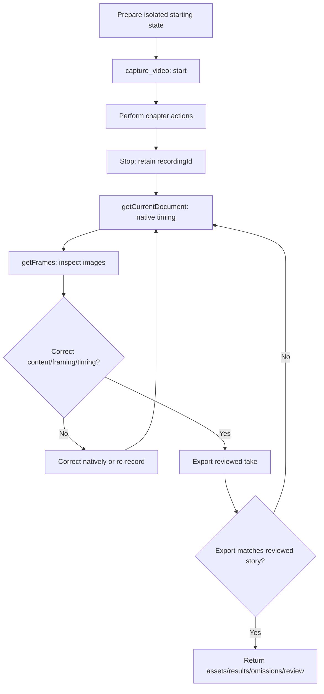

# OpenScreen capture workflow

Included directly; does not require a separate skill invocation. User timing, story, presentation and audio override defaults.

## 1. Prepare the take

- Use consistent, non-sensitive data in the planned starting state. Record only the isolated application window, excluding browser chrome, desktop, notifications and private information. Kiteva owns isolation; OpenScreen owns cursor recording and native frame review.
- Rehearse the approved task before recording. Check opening, busiest state, menu space and payoff at final viewing size. Preserve recognizable context and readable controls; no forced bleed, fixed crop percentage, placeholder content or redesigned UI.

## 2. Record through capture_video

- `reference_browser/capture_video`: `action: "start"` with supported cursor/framing -> same-browser actions -> `action: "stop", recordingId`.
- The adapter passes measured action positions to native setPointerTrack after stopping. Check cursor visibility/click alignment in native frames.
- Stop stops recording without exporting; it returns live descriptions and argument schemas for supported native operations. Retain recordingId. Preserve action order and readable results; captured footage is excluded from the energetic pacing default.
- Native zooms and camera defaults are preserved; never assume zooms were generated or reviewed. Cursor smoothing is disabled (0).
- Make purposeful pointer moves; park away from changing text and results. Preserve actual loading, transitions and feedback; never synthesize a successful response or rewrite animations.

## 3. Read the native document

- All native operations: `action: "edit", recordingId, native: { operation, arguments }`. First operation: `getCurrentDocument`, arguments `{}`. Omit projectId and paths. Use the returned live schemas rather than guessing operation arguments.
- Read source/virtual times and transition windows; never use the export clock for native edits. OpenScreen owns camera animation, cursor following and edit-time mapping. Check errors, partial refusals and `cutTransitions`; partial acceptance is not success.

## 4. Inspect frames before export

- `getFrames` -> inspect returned images at actions/results, page changes, before/during/after every zoom transition and at both boundaries of speed regions. Review the complete active control, label and result, typed text, pointer arrival/click feedback, callouts, privacy and missing/black frames.
- A document read, cursor-track read or contact sheet alone does not replace this native frame review.

## 5. Correct and review again

- Focus: Use addAutoZooms for native click-based suggestions, or addZooms/setZoom deliberately. If clipped, reduce the scale, adjust focus or remove the zoom, then review again. Use removeModifier to stay wide.
- Timing: preserve the complete recorded sequence. Never add trims, skip actions or cut out waiting/typing. Use native addSpeed/setSpeed with the live schemas to accelerate slow portions into the assigned chapter budget. Keep key clicks, results and playback readable at normal speed. Label accelerated intervals clearly. If the complete sequence cannot fit clearly, report a timing conflict instead of exporting an oversized take.
- Annotations must clear content. Re-record wrong windows, missed actions or private content if unfixable; recover with checkpoints.
- After any edit, inspect the affected frames again, including transitions. Do not proceed to export with known clipping or unresolved required framing checks.

## 6. Export the reviewed take

- `action: "export", recordingId` -> validated silent WebM, 60 fps. Only exported assets enter inventory. Export does not add zooms or refill deliberately wide intervals. Preserve presentation; no extra cursor or zoom layer during assembly.

## 7. Reconcile and hand off

- Verify exports against the reviewed take/story; problems loop back to review/correction. Return assets, results, notes and omissions; describe simulated behaviour as simulated.
- Review complete exported playback at final viewing size when available. Fix framing, readability, motion, then polish. If only samples are available, record full-playback review as not checked. Do not invent a playback operation. Record watched coverage, fixes and limitations in reviewNotes; samples cannot certify full motion.
- Sidecar times are source timestamps with trim provenance, not edited cues; use native mapping.
- Optional unavailable operations may be omitted. Missing recording, native review, required correction, export or integration -> exact limitation through the blocking flow; never invent success or substitute illustrations. Unsupported application interactions follow the route's separate omission policy. Respect origin/data boundaries. Chapter duration is an export budget, not a model-call timeout; no installation/publishing.

## Native cursor data

OpenScreen renders/interpolates the cursor and click effects. The adapter converts trusted window-relative mouse events to native fractional positions. Review `getCursorTrack` and frames before export.
